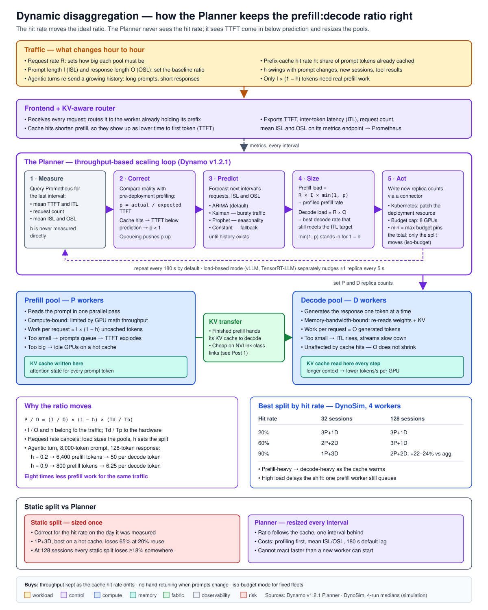
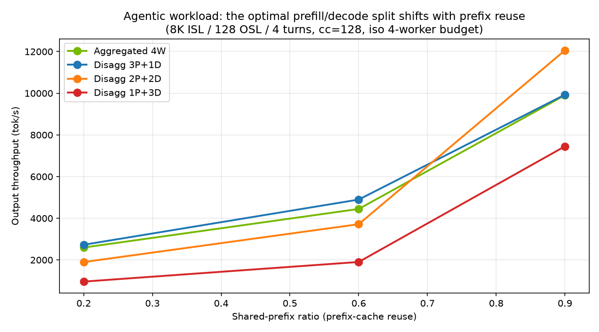

# Dynamic Disaggregation and the Planner

*Field Guide to AI Infrastructure — Disaggregated Serving, Post 2 of 2*
*Maps to outline sections 14.6 (Disaggregation) and 15.4 (NVIDIA Dynamo). [Post 1](./01-when-does-disaggregation-pay.md) covered when disaggregation pays at all; this post covers how many workers each side needs, and why that number has to be allowed to move.*

---

## The problem: a split tuned for yesterday's cache

Here is one cell from the [108-run DynoSim study](../../dynosim-disaggregation-study) behind this series. Agentic traffic, 128 concurrent sessions, 20% of each prompt already sitting in the prefix cache. Four simulated GPU workers, split four different ways:

| Split | Output throughput | p99 time to first token |
|---|---|---|
| 3 prefill + 1 decode | **2,728 tok/s** | 5.5 s |
| 2 prefill + 2 decode | 1,898 tok/s | 8.1 s |
| 1 prefill + 3 decode | 961 tok/s | **16.1 s** |

Same hardware budget, same traffic. The decode-heavy split delivers a third of the throughput and makes the worst-off user wait sixteen seconds for the first token.

Now the uncomfortable part. 1 prefill + 3 decode is not a bad configuration. At 90% cache reuse and 32 concurrent sessions, it is the *best* split in the whole sweep. Someone who measured their traffic on a day when the cache was hot, picked 1P+3D, and shipped it would have made a correct decision. Then a new feature changes the prompts, the cache hit rate falls, and the same fleet loses 65% of its throughput without a single line of configuration changing.

Post 1 ended on the claim that the right prefill:decode ratio moves with the prefix-cache hit rate. This post is about what that means in practice: why it moves, by how much, what it costs when the ratio is wrong, and how NVIDIA Dynamo's Planner turns the ratio from a configuration value into a control loop.

## First principles

*Prefill, decode, TTFT, ITL and the basic disaggregation trade-off are introduced in [Post 1](./01-when-does-disaggregation-pay.md). Five more terms are needed here.*

**The prefill:decode (P:D) ratio.** In a disaggregated deployment, some GPU workers only process prompts (prefill) and some only generate tokens (decode). The P:D ratio is how many of each. "3P+1D" means three prefill workers and one decode worker. It is the single most important sizing decision in a disaggregated fleet, because it decides which pool becomes the bottleneck first.

**The prefix cache.** When a model reads a prompt, it builds a key-value (KV) cache: the intermediate attention state for every token. If the next request begins with the same tokens — the same system prompt, the same conversation history, the same retrieved documents — that state can be reused instead of recomputed. The reused portion is called the prefix.

**The prefix-cache hit rate.** The fraction of a prompt's tokens found already cached. Written *h* below. At *h* = 0.9, nine of every ten prompt tokens are reused, and only one in ten needs real prefill work. In the study, the measured reuse matched the configured shared-prefix ratio closely (0.20, 0.60 and 0.90).

**Iso-budget.** Comparing configurations under the same total number of GPUs. The study holds the fleet at four workers and only changes how they are divided. This isolates the ratio from the question of how big the fleet should be.

**A control loop.** A system that repeatedly measures an output, compares it with a target, and adjusts an input to close the gap. A thermostat is one. The Planner is one: it measures latency and traffic, compares latency with a service-level agreement (SLA), and adjusts the number of prefill and decode workers.

## The mechanism, part 1: why the hit rate moves the ratio

Start with the work each pool has to do per second.

A prefill worker's job is the *uncached* part of each prompt. If requests arrive at rate *R* per second, each with an input sequence length (ISL) of *I* tokens and a hit rate *h*, the prefill pool must process:

> prefill tokens per second = *R* × *I* × (1 − *h*)

A decode worker's job is the response. With an output sequence length (OSL) of *O* tokens:

> decode tokens per second = *R* × *O*

Each pool's size is its work divided by what one worker can sustain. Call the per-worker prefill rate *T*ₚ and the per-worker decode rate *T*_d (both in tokens per second, both properties of the model and the GPU). Then:

> P : D = [ *I* × (1 − *h*) / *T*ₚ ] : [ *O* / *T*_d ]

Rearranged, the ratio has two factors:

> P / D = ( *I* / *O* ) × (1 − *h*) × ( *T*_d / *T*ₚ )

The last factor belongs to the hardware and the model. It is fixed once you have picked them, and it is what pre-deployment profiling measures. The first two factors belong to the traffic. The arrival rate *R* has cancelled out entirely: **load changes how big each pool must be, but under this simple model it does not change the ratio. The hit rate does, directly and linearly.**

For the study's agentic profile, *I* = 8,000 and *O* = 128, so *I*/*O* = 62.5. Moving from *h* = 0.2 to *h* = 0.9 takes (1 − *h*) from 0.8 to 0.1. **The required prefill share of the fleet falls by a factor of eight.** No other workload variable in the sweep moves the ratio that far.

Two things the simple model leaves out, and both show up in the data:

- **Granularity.** Four workers can only express three disaggregated ratios: 3:1, 2:2 and 1:3. The optimum is continuous; the fleet is not. Small fleets jump between ratios; large fleets can track the optimum closely.
- **Queueing.** The simple model assumes each pool runs at a steady rate. Under heavy concurrency, a pool that is "big enough on average" still builds a queue. That is why load *does* change the winner in practice, as the next section shows.

## The mechanism, part 2: how the Planner closes the loop

The Planner is the component of [NVIDIA Dynamo](https://github.com/ai-dynamo/dynamo) that sets replica counts for the prefill and decode pools at runtime. Everything below is from the v1.2.1 release (the version the study used), read from the [design document](https://github.com/ai-dynamo/dynamo/blob/v1.2.1/docs/design-docs/planner-design.md) and [source](https://github.com/ai-dynamo/dynamo/tree/v1.2.1/components/src/dynamo/planner).

It has two scaling modes, which can run together:

- **Throughput-based scaling** sizes both pools from forecast traffic and pre-measured performance curves. It runs every 180 seconds by default and requires profiling data.
- **Load-based scaling** watches per-iteration engine metrics and nudges replica counts up or down by one, on a 5-second default interval. It needs no profiling data. In v1.2.1 it is supported with vLLM only.

When both are on, the throughput-based result acts as a floor and load-based scaling handles bursts above it. This post follows the throughput-based path, because that is the one that sets the ratio. One cycle has five steps:

**1. Measure.** The Planner queries Prometheus, the metrics database, against the Dynamo frontend's metrics endpoint. Per interval it reads average time to first token (TTFT), average inter-token latency (ITL), request count, and average ISL and OSL.

**2. Correct.** Before deployment, a profiling run measured what TTFT and ITL *should* be at each load level. The Planner compares reality with that prediction:

```text
prefill_correction = actual_ttft / expected_ttft
decode_correction  = actual_itl  / expected_itl
```

**This is where the hit rate enters.** The Planner never measures *h* directly. But when prefixes are cached, prefill does less work, TTFT comes in below what profiling predicted, and `prefill_correction` drops below 1. The design document lists prefix-cache hits explicitly as one of the effects these factors absorb, alongside request queueing, chunked prefill inside decode, and the gap between average and actual sequence lengths.

**3. Predict.** A load predictor forecasts the next interval's request count, ISL and OSL. Four are available: Constant (next equals current), ARIMA (the default; a statistical time-series model for trends and seasonality), Kalman (a filter suited to bursty traffic) and Prophet (for complex seasonality). Until enough history exists, the Planner falls back to Constant.

**4. Size.** The prefill pool:

```python
predicted_load   = next_requests * next_isl / interval * min(1, prefill_correction)
prefill_replicas = ceil(predicted_load / interpolated_throughput / gpus_per_engine)
```

Read it against the derivation above. `next_requests * next_isl / interval` is *R* × *I*. `min(1, prefill_correction)` stands in for (1 − *h*). Dividing by profiled throughput is dividing by *T*ₚ. The Planner is computing the left side of the ratio, with the hit rate inferred from latency rather than counted.

The decode pool is sized differently, because decode latency depends on how much context each step must read:

```python
corrected_itl      = target_itl / decode_correction
throughput_per_gpu = decode_interpolator.find_best_throughput_per_gpu(
                         itl=corrected_itl,
                         context_length=next_isl + next_osl / 2)
decode_replicas    = ceil(next_num_req * next_osl / interval / throughput_per_gpu / gpus_per_engine)
```

It finds the highest per-GPU decode throughput that still meets the ITL target at the predicted context length, then divides total decode work (*R* × *O*) by it.

**5. Act.** The Planner writes the new counts to the deployment through a connector. On Kubernetes it patches the DynamoGraphDeployment resource and lets the operator reconcile. A virtual connector exists for other orchestrators.

**The budget.** By default the Planner sizes each pool to meet its SLA and lets the total float, capped at `max_gpu_budget` (default 8 GPUs). Setting `min_gpu_budget` equal to `max_gpu_budget` pins the total, and the Planner then only redistributes workers between the two pools. That is exactly the iso-budget question the study asks. When the clamp applies, v1.2.1 scales both targets proportionally; the code notes an SLA-pressure-aware split as future work.



## The numbers

All throughput figures below are medians of four complete runs of the sweep (the published CSV plus three re-runs on the same `ai-dynamo` 1.2.1 release, October 2026). Percentages are relative to the best split in that cell. Simulation results, not hardware benchmarks — see Methods.

**Agentic traffic (8,000-token prompts, 128-token responses, 4 turns), throughput by split:**

| Hit rate | Concurrency | Aggregated | 3P+1D | 2P+2D | 1P+3D | Winner |
|---|---|---|---|---|---|---|
| 0.2 | 32 | −2% | **best** | −3% | −51% | 3P+1D |
| 0.6 | 32 | −16% | −17% | **best** | −42% | 2P+2D |
| 0.9 | 32 | −12% | −9% | −4% | **best** | 1P+3D |
| 0.2 | 128 | −5% | **best** | −30% | −65% | 3P+1D |
| 0.6 | 128 | −9% | **best** | −24% | −61% | 3P+1D |
| 0.9 | 128 | −18% | −18% | **best** | −38% | 2P+2D |



Four things to read from it:

- **At 32 sessions, the winner walks across the table exactly as the derivation predicts:** prefill-heavy at low reuse, balanced in the middle, decode-heavy at high reuse.
- **At 128 sessions, the walk is delayed.** 3P+1D still wins at 60% reuse, and the decode-heavy split never wins. With 128 concurrent sessions, one prefill worker is a queue even when each prompt is 90% cached: 1P+3D's p99 TTFT at 0.9 reuse is 2.1 s against 1.1 s for 2P+2D. Load does not move the ideal ratio in the simple model; it moves the penalty for undersizing a pool.
- **Aggregated serving never wins agentic throughput in these six cells.** At 90% reuse and 128 sessions, 2P+2D delivered about 12,060 tok/s against 9,716–9,906 for aggregated across the four runs: **+22% to +24%**. The aggregated figure is one of the two noisiest cells in the sweep (2.0% spread); every disaggregated cell here varied by well under 1%.
- **The cost of a wrong static split is larger than the gain from the right one.** The best case is +22–24% over aggregated. The worst case for a reasonable-looking static split is −65%.

**What each static split risks, across the three hit rates:**

| Static split | Worst cell at 32 sessions | Worst cell at 128 sessions |
|---|---|---|
| 3P+1D | −17% (at 0.6 reuse) | −18% (at 0.9 reuse) |
| 2P+2D | −4% (at 0.9 reuse) | −30% (at 0.2 reuse) |
| 1P+3D | −51% (at 0.2 reuse) | −65% (at 0.2 reuse) |

At moderate load, 2P+2D is a safe static choice: never more than 4% from the best. At high load, **every static split loses at least 18% somewhere in a realistic range of hit rates.** That is the quantitative case for a planner: not that the best split is much better, but that no fixed split is safe once load is high and the cache hit rate is allowed to drift.

**Planner defaults, v1.2.1:** 180-second throughput adjustment interval; 5-second load-based interval; ARIMA predictor; 30-second startup delay before the first decision; GPU budget cap of 8; minimum of one worker per pool.

## Worked example: following one agentic turn

Take a single turn in the agentic profile: an 8,000-token prompt (system instructions, tool definitions, conversation so far, the last tool result) and a 128-token response (the next tool call).

**At 20% reuse**, 6,400 of the 8,000 prompt tokens need prefill. Against 128 tokens of decode, that is 50 prefill tokens for every decode token. Prefill dominates. The best available split puts three workers on it: 3P+1D, which wins at both load levels.

**At 90% reuse**, only 800 tokens need prefill — 6.25 per decode token, eight times less prefill work for exactly the same traffic. Three prefill workers would now spend most of their time idle while one decode worker carries every generated token. The derivation says the fleet should swing toward decode. At 32 sessions it swings all the way to 1P+3D. At 128 sessions it stops at 2P+2D, because a single prefill worker serving 128 concurrent sessions still queues.

**What the Planner sees as this happens.** Nothing in its inputs says "the hit rate rose." Average ISL is still 8,000. What changes is TTFT: prefill is doing an eighth of the work profiling assumed, so observed TTFT drops well below the prediction and `prefill_correction` falls. The next sizing pass multiplies the prefill load estimate by that smaller factor, asks for fewer prefill replicas, and — if the budget is pinned — hands the freed GPUs to decode. The ratio follows the cache, one adjustment interval behind it.

Where this example came from matters. Agentic workloads are where the hit rate swings hardest, because each turn re-sends a growing history. A tool result that changes the conversation, a new session, or a changed system prompt can all reset what is cached. The same customer can sit at 90% reuse in one hour and 30% in the next.

## Trade-offs, and when not to use a planner

**Chat-shaped traffic.** Post 1's finding stands: for short prompts and longer responses, aggregated serving won every cell in the study. A planner that tunes the ratio of a disaggregated fleet does not help a workload that should not be disaggregated. In v1.2.1 the load-based mode can scale aggregated deployments too, but that is replica scaling, not ratio tuning.

**Stable traffic.** If the hit rate and the ISL/OSL mix genuinely do not move, measure once, pick the split, and save the operational surface. The table above says 2P+2D-style balanced splits are forgiving at moderate load.

**Profiling is a prerequisite.** Throughput-based scaling needs pre-deployment profiling for each model, GPU and parallelism combination: either real GPU sweeps or AI Configurator estimates. That is real work, and it goes stale when the model, engine version or hardware changes.

**The loop is slower than some traffic.** At the 180-second default, a burst that lasts a minute is over before the throughput path reacts. The load-based mode exists for that, with its own constraint: one replica of change per 5-second step, and vLLM only in this release.

**Scaling up pays the full cold start.** A new worker has to be scheduled, pull its container, load weights and register before it helps. If that takes longer than the adjustment interval, decisions overlap. The design document says so directly and recommends shorter intervals only for workloads with fast model loading. (Cold starts get their own leaf in Part 16.)

## How it fails in production

**Flapping.** *Symptom:* replica counts oscillating every interval; scaling events that never finish before the next one starts. *Cause:* adjustment interval shorter than real scaling time, or correction factors swinging during a traffic ramp. *Check first:* time from a scale-up decision to the new worker serving its first request, against the configured interval. The Planner logs a warning when decisions pile up; it does not queue them.

**Poisoned correction factors.** *Symptom:* the Planner sizes badly right after a deployment or restart, then slowly recovers. *Cause:* cold caches and warm-up effects distort observed TTFT and ITL, and the factors faithfully learn the distortion. *Check first:* the factor values over the first few intervals. The documented remedy is `--no-correction` while cold-start artifacts dominate.

**One number carrying two opposite signals.** *Symptom:* TTFT climbing under burst load while the prefill pool does not grow. *Cause:* this one follows from the formula rather than from documented incidents. Cache hits push `prefill_correction` down; queueing pushes it up. The `min(1, …)` clamp means a factor above 1 is ignored, so queueing pressure cannot raise the prefill estimate through this path. Bursts are what the load-based mode is for. *Check first:* whether load-based scaling is enabled alongside throughput-based scaling, and whether your backend supports it.

**Averages hiding two workloads.** *Symptom:* SLA misses on one class of request while aggregate metrics look healthy. *Cause:* throughput-based sizing uses average ISL and OSL, which the design document lists as a known limitation for bimodal or heavy-tailed traffic. An agentic fleet that also serves short chat turns is exactly that shape. *Check first:* the ISL histogram, not the mean. Consider separate deployments per traffic class.

**Scaling that disturbs the cache it depends on.** *Symptom:* hit rate dropping right after scale events. *Cause (my reasoning, not documented behaviour):* a new worker starts with an empty cache, and requests routed to it miss prefixes that were warm elsewhere. The lower hit rate raises the prefill estimate on the next pass, which can trigger more scaling. Dynamo's KV-aware router routes on cached prefixes, which should limit this. *Check first:* hit rate per worker before and after a scale event.

## The interview version

*About 90 seconds, spoken.*

"In disaggregated serving, you split GPUs into prefill workers that read the prompt and decode workers that generate the response, and the ratio between them is the main sizing decision. The ratio depends mostly on how much of each prompt is already in the prefix cache. Prefill only has to process the uncached tokens, so when the cache hit rate goes from 20% to 90%, prefill work drops eightfold for the same traffic.

I measured this in a 108-run DynoSim study. At low reuse, three prefill and one decode was best. At high reuse, the winner moved toward decode-heavy splits. The bigger finding was the downside: a decode-heavy split that's best on a hot cache lost 65% of its throughput when reuse dropped to 20%, and at high load every static split lost at least 18% somewhere in the range.

That's the case for Dynamo's Planner. Every three minutes by default, it reads TTFT, ITL and traffic from Prometheus, compares latency with what profiling predicted, and resizes both pools. It never measures the hit rate directly — cache hits show up as TTFT coming in below prediction, which lowers the prefill estimate. So the ratio follows the cache, one interval behind. The limits are that it needs profiling up front, it works from averages, and it can't react faster than a new worker can start."

## Methods, honestly

These are discrete-event simulation results from [NVIDIA Dynamo's DynoSim](https://docs.nvidia.com/dynamo/user-guides/dynosim) mocker engine with its default timing model — **not hardware benchmarks and not AI Configurator-calibrated GPU timing.** The relative behaviour across configurations is the finding; the absolute throughput numbers are not.

The study holds the fleet at four workers and compares fixed splits; it does not run the Planner itself. The link between the two is the derivation and the Planner's published sizing formulas, not a measured closed-loop experiment. Running the Planner against the mocker with a shifting hit rate is the natural next step.

The full sweep reproduces in about 25–35 seconds on a CPU. Across four complete runs, 106 of 108 cells varied by less than 1%; the two exceptions are aggregated agentic cells (2.0% and 2.6% spread). Code, data and charts are [in the study folder](../../dynosim-disaggregation-study).

## Further reading

- **Dynamo Planner design document, v1.2.1** — architecture, the sizing formulas above, known limitations. [GitHub](https://github.com/ai-dynamo/dynamo/blob/v1.2.1/docs/design-docs/planner-design.md)
- **Dynamo Planner source, v1.2.1** — scaling modes, defaults (`config/defaults.py`) and budget clamping (`core/budget.py`). [GitHub](https://github.com/ai-dynamo/dynamo/tree/v1.2.1/components/src/dynamo/planner)
- **Zhong et al., "DistServe: Disaggregating Prefill and Decoding for Goodput-optimized Large Language Model Serving," OSDI 2024** — the case for separating the phases and sizing each against its own latency target. [arXiv:2401.09670](https://arxiv.org/abs/2401.09670)
- **Patel et al., "Splitwise: Efficient Generative LLM Inference Using Phase Splitting," ISCA 2024** — phase splitting across machine pools, including mixed hardware. [arXiv:2311.18677](https://arxiv.org/abs/2311.18677)
- **When Does Disaggregation Pay? — the DynoSim study** — the 108-run sweep this post draws on. [GitHub](../../dynosim-disaggregation-study)

---

*Previous: [Post 1 — When Does Disaggregation Pay?](./01-when-does-disaggregation-pay.md)*
