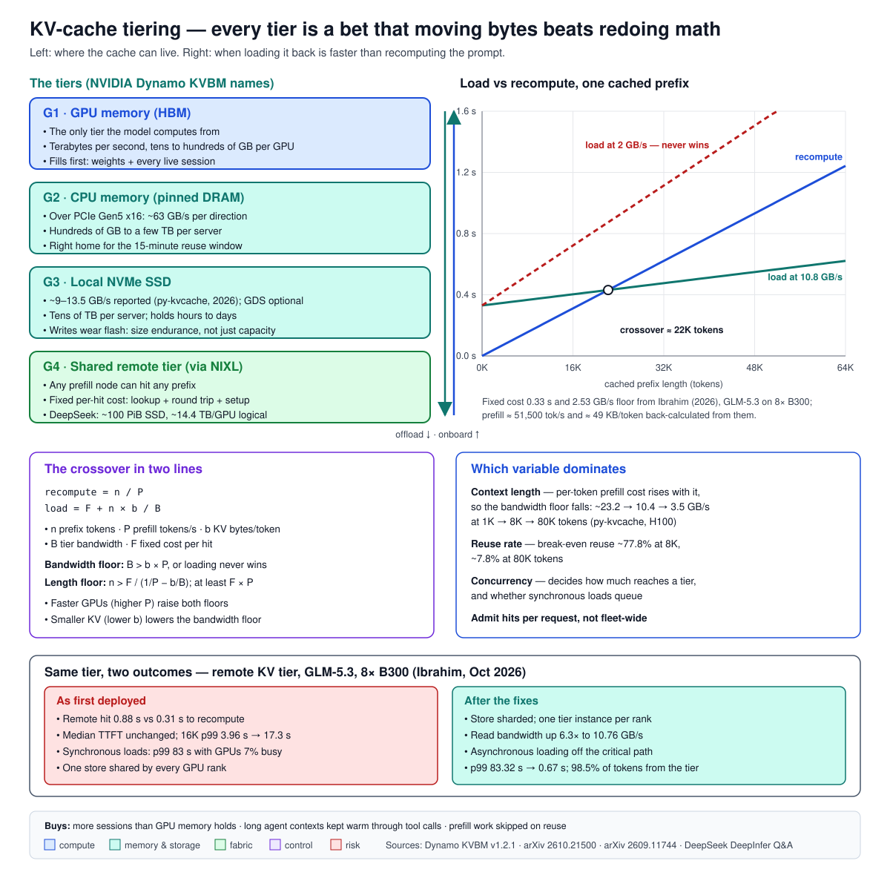

# KV-Cache Tiering Below GPU Memory

*Field Guide to AI Infrastructure — KV-Cache Engineering, Post 1*
*Maps to outline section 14.4 (KV-cache engineering and tiered KV). Builds on the [disaggregation posts](../disaggregation/), which treat the prefix-cache hit rate as the variable that sizes a fleet. This post is about where that cache lives once it no longer fits on the GPU, and when keeping it there is slower than throwing it away.*

---

## The problem: a cache that made the tail worse

In October 2026 an engineer added a shared remote KV-cache tier to a disaggregated deployment of GLM-5.3, a large mixture-of-experts model, running on 8-GPU B300 nodes. The idea is standard: when a prompt starts with tokens some earlier request already processed, fetch the saved attention state from the tier instead of computing it again.

[The result](https://arxiv.org/abs/2610.21500) was not what the idea promised. Median time to first token did not move. The 99th-percentile time to first token for 16,000-token prompts went from 3.96 s to 17.3 s. The cause, once found, was simple: **a remote cache hit took 0.88 s to load. Recomputing the same prompt took 0.31 s.** On a hit-heavy request stream with synchronous loading, the tail grew to 83 s while the GPUs sat 7% busy, waiting on storage.

The fix worked — after sharding the store, giving each GPU rank its own tier instance and loading asynchronously, p99 fell from 83.32 s to 0.67 s, with 98.5% of prompt tokens served from the tier. But the first result is the lesson. **Every tier below GPU memory is a bet that moving bytes is cheaper than redoing math.** The bet can lose, and when it does, the median hides it.

This post is about how to know in advance which way the bet goes.

## First principles

**The key-value (KV) cache.** When a transformer model reads a prompt, every layer computes a *key* and a *value* vector for every token, so later tokens can attend to earlier ones. Keeping those vectors is the KV cache. Without it, generating each new token would mean reprocessing the whole conversation. With it, the model reads its memory instead.

**How big it is.** The size per token is a product of the model's shape:

> KV bytes per token = 2 (key and value) × layers × KV heads × head dimension × bytes per number

For Llama 3.1 70B — 80 layers, 8 KV heads, head dimension 128 — at 16-bit precision that is 2 × 80 × 8 × 128 × 2 = **327,680 bytes, or 320 KiB per token**. A 32,000-token conversation holds 10 GiB of KV cache. A 128,000-token one holds 40 GiB, half an H100's memory, for one user. Storing it at 8-bit precision halves those numbers.

**Prefill and recompute.** Prefill is the phase that reads the prompt and builds the KV cache. "Recompute" means running prefill again for tokens whose cache was thrown away. It costs GPU time, and it is the alternative every tier competes with.

**The tiers.** NVIDIA Dynamo's KV Block Manager (KVBM) names four, and the names are now common vocabulary ([KVBM design, v1.2.1](https://docs.nvidia.com/dynamo/zh-CN/v1.2.1/design-docs/component-design/kvbm-design)):

- **G1 — GPU memory.** High-bandwidth memory (HBM) on the GPU. The only tier the model can compute from directly.
- **G2 — CPU memory.** Pinned host DRAM, reached over PCIe or a CPU–GPU link.
- **G3 — local SSD.** NVMe flash in the same server, optionally read straight into GPU memory with GPUDirect Storage (GDS).
- **G4 — remote storage.** A shared store across the cluster, "an opaque blob store accessed through NIXL", NVIDIA's transfer library.

**A hit, and offload.** A *hit* is a prompt prefix found in some tier. *Offload* (or demotion) moves blocks down a tier when GPU memory is needed; *onboarding* moves them back up before use. *Eviction* deletes them.

## The mechanism: when loading beats recomputing

Treat one cached prefix of *n* tokens. There are two ways to get its KV cache into GPU memory.

**Recompute it.** If the GPU prefills *P* tokens per second, recompute takes:

> *t*_recompute = *n* / *P*

**Load it.** If each token's cache is *b* bytes, the tier delivers *B* bytes per second, and every hit pays a fixed cost *F* (the lookup, the request round trip, the setup of the copy), loading takes:

> *t*_load = *F* + *n* × *b* / *B*

Loading wins when *t*_load < *t*_recompute. Rearranged:

> *n* × (1/*P* − *b*/*B*) > *F*

Two conditions fall out, and they are the whole leaf in miniature.

**Condition 1 — a bandwidth floor.** The bracket must be positive: 1/*P* > *b*/*B*, or

> *B* > *b* × *P*

Below that bandwidth, loading a token takes longer than computing it, and no prompt is long enough to win. The floor rises with bytes per token and with how fast the GPU prefills. **Faster GPUs make storage tiers harder to justify, not easier.**

**Condition 2 — a length floor.** Above the bandwidth floor, the prefix must still be long enough to pay off the fixed cost: *n* > *F* / (1/*P* − *b*/*B*). Even with infinite bandwidth, prompts shorter than *F* × *P* tokens are cheaper to recompute.

The GLM-5.3 paper fits exactly this model. For its model and GPUs it reports a bandwidth floor of **2.53 GB/s** and a fixed per-hit cost of about **0.33 s**, so prompts under about **17,000 tokens never win at any bandwidth**. (Working backwards from those three numbers, the deployment prefilled roughly 50,000 tokens per second and stored roughly 50 KB of KV per token — my arithmetic, not the paper's.) The fix attacked both terms: per-rank tier instances raised the store's read bandwidth 6.3× to 10.76 GB/s, and asynchronous loading stopped slow fetches from blocking prefill. At 10.76 GB/s the same model puts the crossover near 22,000 tokens — the point plotted in the diagram below (my arithmetic).

**Which variable dominates.** Three candidates: context length, reuse rate and concurrency.

- **Context length dominates the per-hit decision.** Prefill cost per token rises with context, because each new token attends to every earlier one, so *P* falls as prompts grow and the bandwidth floor falls with it. A September 2026 study of NVMe-backed KV caching for vLLM ([py-kvcache](https://www.alphaxiv.org/abs/2609.11744), small 3–4B models on H100) reported the bandwidth needed for a fully cached prompt to match recompute: about **23.2 GB/s at 1,000 tokens, 10.4 GB/s at 8,000 and 3.5 GB/s at 80,000**. Its NVMe path sustained roughly 9–13.5 GB/s. Short prompts could not win on that hardware; long ones won easily.
- **Reuse rate decides whether the tier pays overall.** The same study found that at 8,000 tokens a prompt needed about **77.8%** of its prefix reused to break even; at 80,000 tokens, about **7.8%**. A tier that holds long contexts pays at almost any reuse; a tier that holds short ones needs reuse it rarely gets.
- **Concurrency decides how much ever reaches the tier.** With few users, everything fits in GPU memory and tiers are idle. With many, GPU memory fills, blocks are demoted, and the tier carries the load. Concurrency also decides whether loading is synchronous enough to queue — the GLM-5.3 failure.

The study's own conclusion is the right default: treat external KV caching as **a setup-specific admission decision**, made per request, not a switch turned on for the fleet.

## The numbers

Each figure below is labelled with who measured it. Vendor figures are the vendor's.

**Independent and research results:**

| Result | Source, date |
|---|---|
| Remote hit 0.88 s vs 0.31 s recompute; 16K p99 3.96 s → 17.3 s; after fixes p99 83.32 s → 0.67 s, 98.5% of tokens from tier; floor 2.53 GB/s, ~17K-token minimum | [Ibrahim, arXiv:2610.21500](https://arxiv.org/abs/2610.21500), Oct 2026 |
| Bandwidth to match recompute: ~23.2 / 10.4 / 3.5 GB/s at 1K / 8K / 80K tokens; break-even reuse ~77.8% at 8K vs ~7.8% at 80K; TTFT gain over recompute 2.2× at 1K to 32.8× at 80K for repeated long documents (LMCache / vLLM offload) | [py-kvcache, arXiv:2609.11744](https://www.alphaxiv.org/abs/2609.11744), Sep 2026 |
| One year of a production serving trace (6.1 billion requests, 9,174 models): 99% of prefix reuse arrives within 15 minutes of the previous request; LRU and FIFO eviction often match or beat more complex policies | [Nixon et al., arXiv:2608.13573](https://arxiv.org/html/2608.13573v1), Jul 2026 |
| Object storage as a tier: per-layer compute window at 87.5% hit rate is 1.98 ms at 4K tokens vs 23.85 ms at 32K, so object-store latency hides at long context and not at short | [ObjectCache, arXiv:2605.22850](https://arxiv.org/abs/2605.22850), 2026 |

**Production, first-party:** DeepSeek's [deployment notes for DeepSeek-V4.1-Flash](https://github.com/deepseek-ai/DeepInfer/blob/main/doc/inference_deployment_qa.md) describe roughly **100 PiB of SSD** in its 3FS distributed file system holding KV cache, about **14.4 TB per GPU** in logical size, a time-to-live of **3 days for agent traffic and 7 days for chatbot traffic**, and storage servers sized to retain at least 24 hours of data. Because "every prefill machine [can] hit any prefix," there is no prefix-affinity routing. In March 2025, DeepSeek reported [56.3% of a day's input tokens hitting its on-disk cache](https://github.com/deepseek-ai/open-infra-index/blob/main/202502OpenSourceWeek/day_6_one_more_thing_deepseekV3R1_inference_system_overview.md).

**Vendor results (cite as vendor numbers):**

- **Nebius and WEKA**, [8-hour test on HGX B300](https://nebius.com/blog/posts/nebius-weka-shared-kv-cache-benchmark-hgx-b300) (September 2026), DeepSeek-V4-Pro on one 8-GPU node with a shared cache tier: 55,694 vs 23,015 requests served (2.4×); uncached prefill 4,400 vs 33,900 tokens per request; median TTFT 1.05 s vs 5.68 s.
- **WEKA and Oracle Cloud**, [72 H100 GPUs](https://blogs.oracle.com/ai-and-datascience/scaling-long-context-inference-on-oci-with-wekas-augmented-memory-grid) (May 2026), 100K-token context: about 2 million vs under 200,000 tokens per second against an HBM-plus-DRAM baseline (standard vLLM).
- **Compression before tiering.** The SGLang, Qwen and NVIDIA teams [report NVFP4 KV cache](https://www.lmsys.org/blog/2026-09-16-nvfp4-kv-cache) (September 2026) at about 56% of FP8's storage, with decode throughput up 37% at 32K tokens and 78% at 1M at the same memory capacity — 26–30% at matched batch size, labelled experimental. TensorRT-LLM can [compress pages to NVFP4 as they are offloaded](https://nvidia.github.io/TensorRT-LLM/latest/features/kv-cache-compression.html) to host or disk; the mode is opt-in, enabled through the cache-compression configuration.

## Worked example: sizing a tier for an agent fleet

*Illustrative numbers, chosen to show the method. Measure your own.*

A team serves Llama 3.1 70B to coding agents on 8-GPU nodes, KV cache stored at 8-bit precision: **160 KiB per token**. A typical agent session builds to 64,000 tokens of context over many turns.

**Step 1 — one session's footprint.** 64,000 × 160 KiB ≈ **10 GiB**. A node of eight 80 GB GPUs holds 640 GB; after about 70 GB of FP8 weights and working memory for activations, roughly 50 such sessions fit at once before anything is demoted.

**Step 2 — what the tier must hold.** Agents pause. During a tool call — a test run, a search, a file read — the session's cache sits idle in GPU memory while new sessions want the space. If each node runs 200 active agents and each pauses often, most sessions are idle at any moment. To keep every session from the last 15 minutes warm — the window that holds 99% of reuse in the production trace above — the node needs roughly 200 × 10 GiB = **2 TiB** below GPU memory, about 250 GiB per GPU. That fits in host DRAM on a large server. A 24-hour window for returning users would not: that is a local-NVMe or shared-tier job — the scale DeepSeek runs at, 14.4 TB per GPU, for multi-day retention.

**Step 3 — does loading beat recompute?** Suppose the node prefills 20,000 tokens per second for this model (an assumption — profile it). The bandwidth floor is 160 KiB × 20,000 ≈ **3.3 GB/s**. Host DRAM over a PCIe Gen5 x16 link (32 GT/s × 16 lanes, about 63 GB/s per direction before protocol overhead) clears it easily. Local NVMe at the 9–13.5 GB/s the py-kvcache study reported clears it. A remote tier delivering 2 GB/s to the node does not, at any prompt length. If the fixed per-hit cost on the remote tier is 0.2 s, the length floor at infinite bandwidth is 0.2 × 20,000 = **4,000 tokens**; at 10 GB/s to the node it is about 6,000. (All bandwidths here are per node, matching the node-level prefill rate.) Agent sessions at 64,000 tokens are far above either.

**Step 4 — the answer.** Host DRAM for the 15-minute window; local NVMe or a shared tier for longer reuse, admitted only for prefixes above the length floor; and every hit loaded asynchronously, so a slow fetch delays one request rather than queueing all of them.

**An anchor contrast.** On one production GPU program — a real-time bidding platform — a shared NVMe file system was already in the design, as the checkpoint tier: the GPUs wrote about 1.2 TB of training state over GPUDirect Storage every three minutes, so a failed node could be replaced without losing the hour. Same storage idea, opposite job. Checkpointing is a large, infrequent, sequential write. KV tiering is many small, latency-critical reads in the request path. **A storage tier is judged by its access pattern, not its capacity.**

## Trade-offs, and when not to tier

**Short prompts.** Below the length floor, every hit is a loss. Chat traffic with short shared system prompts often lives here; keep those in GPU memory or recompute them.

**Tiny-KV models.** DeepSeek reports its V4.1-Flash model's global, always-in-HBM KV cache at [890 bytes per token](https://arxiv.org/abs/2609.19969) — about 370 times smaller than Llama 3.1 70B's at 16-bit (DeepSeek counts its longer-lived host and SSD cache separately). Two things follow. Far more sessions fit in GPU memory, so less ever needs a tier. And when something does, each load moves so few bytes that the fixed per-hit cost dominates. Model design can do more for memory pressure than a storage tier can.

**Compress first.** Storing KV at 8-bit or 4-bit precision fits two to four times more sessions before anything spills. It costs accuracy risk and conversion work, but it is cheaper than a storage cluster.

**Flash wears out.** KV caching writes constantly. A [paper on flash endurance for KV offload](https://arxiv.org/abs/2610.30791) (October 2026) reports that KV writes can shorten SSD lifetime "from years to months", and proposes write reduction that extends it 7.3× on average. Size endurance, not just capacity.

**Shared tiers are a security boundary.** Once one tenant's KV cache sits on storage another tenant's requests can reach, cache isolation becomes an access-control question. (Part 19 covers confidential computing.)

## How it fails in production

**Median fine, tail broken.** *Symptom:* p50 TTFT unchanged after adding a tier; p99 several times worse. *Cause:* slow hits on the minority of requests that hit, or hits on prompts below the length floor. *Check first:* TTFT split by hit vs miss and by prompt length, not the aggregate.

**Synchronous loading builds a queue.** *Symptom:* GPUs idle while latency climbs — 7% busy at an 83 s p99 in the GLM-5.3 case. *Cause:* prefill waits for each fetch to finish before starting. *Check first:* GPU utilisation during hit-heavy periods; whether the connector loads asynchronously.

**One store, every rank.** *Symptom:* remote-tier bandwidth far below the network's. *Cause:* all GPU ranks of a parallel prefill share one store instance and serialise. *Check first:* per-rank read bandwidth; the GLM-5.3 fix was a store instance per rank.

**Agent sessions evicted during tool calls.** *Symptom:* agent turns after a long tool call as slow as first turns. *Cause:* the idle session's KV was evicted from GPU memory instead of demoted, so the next turn recomputes 60,000 tokens. *Check first:* whether offload to G2/G3 is enabled, and hit rate on post-tool-call turns specifically.

**Compression configured but not active.** *Symptom:* tier capacity filling at full-precision rates. *Cause:* cold-page compression in TensorRT-LLM is opt-in and requires specific GPUs and cache-manager settings. *Check first:* the KV dtype actually written to the host and disk tiers.

**Stale cache after a model change.** *Symptom:* subtly wrong outputs after a deployment. *Cause (my reasoning):* KV computed by one model version is meaningless to another; a shared tier must key entries by model version, precision and parallelism layout. *Check first:* the cache key, before the first rollout.

## The interview version

*About 90 seconds, spoken.*

"Once a model's KV cache doesn't fit in GPU memory, you can push it down to CPU memory, local SSD or a shared storage tier. Every one of those is a bet that loading the bytes back is faster than recomputing the prompt.

You can write the bet down. Recompute time is prompt length over prefill speed. Load time is a fixed per-hit cost plus bytes over bandwidth. Two things come out. There's a bandwidth floor — bytes per token times prefill speed — and below it loading never wins. And there's a length floor, because of the fixed cost, so short prompts should always be recomputed.

A paper in October 2026 shows what happens when you skip that. Adding a remote tier left median TTFT unchanged, but a remote hit took 0.88 seconds against 0.31 to recompute, and p99 went from about 4 seconds to 17. After they sharded the store per GPU rank and made loading asynchronous, p99 dropped from 83 seconds to under one.

So I size a tier in three steps: KV bytes per token from the model's shape, how much must stay warm from the reuse window, and the crossover from measured prefill speed and tier bandwidth. Then I admit hits per request, not fleet-wide."

## Further reading

- **Ibrahim, "When the KV Cache Is Slower Than the GPU: Scaling Remote KV Tiers for Context-Parallel Prefill" (Oct 2026)** — the crossover model and the fixes. [arXiv:2610.21500](https://arxiv.org/abs/2610.21500)
- **Kanichai, De Matteis and Trivedi, "Building py-kvcache" (Sep 2026)** — bandwidth and reuse break-even by context length on H100. [arXiv:2609.11744](https://www.alphaxiv.org/abs/2609.11744)
- **Nixon et al., "A Year in LLM Serving: Workload Evolution, Caching and Load-Balancing" (Jul 2026)** — reuse timing, eviction policies and the cache-versus-load-balancing conflict. [arXiv:2608.13573](https://arxiv.org/html/2608.13573v1)
- **NVIDIA Dynamo KV Block Manager design, v1.2.1** — the G1–G4 tiers and NIXL's role. [docs.nvidia.com](https://docs.nvidia.com/dynamo/zh-CN/v1.2.1/design-docs/component-design/kvbm-design)
- **LMCache architecture** — a KV-cache layer connected to the engine that tiers GPU → CPU → local disk → remote. [docs.lmcache.ai](https://docs.lmcache.ai/developer_guide/architecture.html)
- **DeepSeek, DeepInfer deployment Q&A** — the production shape of a 100 PiB shared KV tier. [GitHub](https://github.com/deepseek-ai/DeepInfer/blob/main/doc/inference_deployment_qa.md)
