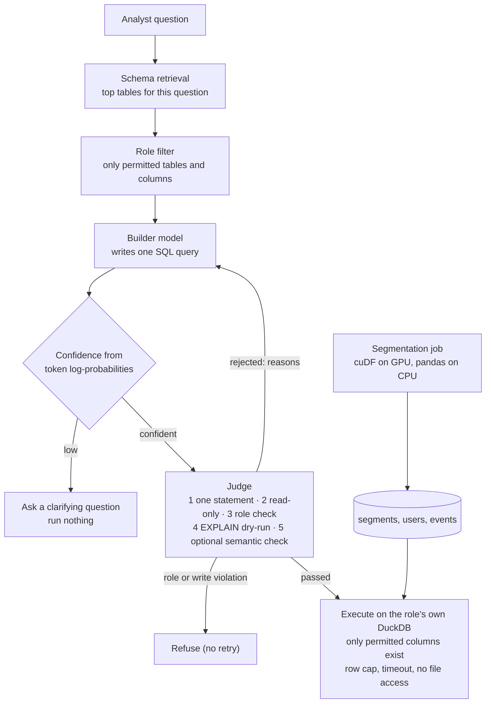

# GPU Analytics with a Guarded Natural-Language-to-SQL Layer

**Audience segmentation written once for RAPIDS cuDF (GPU) or pandas (CPU), and a
Builder + Judge natural-language-to-SQL (NL-to-SQL) layer that never runs a query until it
is safe, permitted and plausible — and asks a clarifying question when the model is unsure.**

> **Honest framing.** This is not client code and it is not a benchmark of the production
> system. It rebuilds the design as runnable, tested code on synthetic data. Every claim is
> labelled: **Measured** (produced by code here), **Tested** (behaviour verified by tests
> with a scripted model stand-in), or **Designed** (written to run against a real model or
> GPU, not run here). This repo reports **no** NL-to-SQL accuracy numbers, because no real
> model is run.

## The problem

Marketing teams wanted audience answers ("lapsed CTV users in the west who used to buy")
without waiting days for an analyst to write SQL. Two things stood in the way:

- **The data was big** (context from the production system, not reproduced here): tens
  of millions of users and billions of events made Spark segmentation jobs take hours.
  RAPIDS cuDF runs the same dataframe operations on GPUs.
- **Generated SQL fails in ways users can't see.** A query that runs is not necessarily
  right. A model can join the wrong table, invent a column, filter on the wrong month, or
  read data the user isn't allowed to see. An NL-to-SQL layer needs guardrails before it
  needs a better prompt.

## Architecture



## Design decisions

### 1. One segmentation codebase, GPU or CPU — *Measured (CPU)*, [`segmentation/segment.py`](segmentation/segment.py)

cuDF implements the pandas API on the GPU, so the job imports cuDF when present and falls
back to pandas otherwise; the groupbys, joins and filters are identical. It computes
recency, frequency and spend features and assigns four segments (high value, engaged
viewer, lapsed, casual).

On the synthetic dataset (200,000 users, 4,000,000 events), the CPU fallback loads in
about 0.2 s and segments in about 0.4 s on a 2-core sandbox
([`results/segmentation.json`](results/segmentation.json)). That shows the code runs end to
end. It is **not** a GPU speedup measurement: no GPU run is reported here. Data larger than
one GPU's memory would go through `dask_cudf` with the same operations.

### 2. Access control in three layers — *Tested*, [`nl2sql/rbac.py`](nl2sql/rbac.py), [`nl2sql/warehouse.py`](nl2sql/warehouse.py)

- **Schema retrieval** picks the tables most relevant to the question, ranked only over
  what the role can see. Here it is a dependency-free text similarity; with hundreds of
  tables it would use an embedding index.
- **Layer 1: the prompt.** Tables and columns the role may not read are removed before the
  prompt is built. A marketing role sees segments and coarse user attributes only.
- **Layer 2: the parsed SQL.** The Judge checks every table and column against the role
  and gives the Builder a clear reason. It also rejects the indirect ways SQL can reach a
  column without naming it: case variants, whole-row references (`SELECT u FROM users u`),
  regex selection (`COLUMNS('sign.*')`), positional references (`#4`) and alias renaming.
  A role violation is refused outright, not retried.
- **Layer 3: the database, which is the actual boundary.** Each role queries its own DuckDB
  connection that contains only the columns it may read. Restricted data is not hidden from
  the query; it is absent. A security boundary should not depend on enumerating SQL syntax.
- **Tested against 55 attack queries** written by an independent review: none returned
  restricted data at layer 3, and the only one that passed layer 2 reads a harmless setting.
  Thirteen of them are in the test suite.

### 3. The Judge: nothing reaches the database unchecked — *Tested*, [`nl2sql/judge.py`](nl2sql/judge.py)

Checks run cheapest first:

| Check | Catches |
|---|---|
| Exactly one statement | Stacked queries (`SELECT 1; DROP TABLE users`) |
| Read-only | `DELETE`, `DROP`, `COPY`, `ATTACH`, `PRAGMA`, `SET`, and table functions that read files (`read_csv('/etc/passwd')`) |
| Role check on the parsed SQL | Restricted tables and columns (including the indirect forms above), `SELECT *` on partly restricted tables |
| `EXPLAIN` dry-run against the real schema, no data scanned | Invented columns, wrong table names, type errors |
| Optional semantic check by a second model call | Valid SQL that answers the wrong question |

A rejection sends its reasons back to the Builder for one retry. The demo shows a query
that used a non-existent column `type`, was rejected by the dry-run, and was fixed on the
second attempt.

**Defence in depth:** the execution connection itself has external file access disabled
and its configuration locked. Even if a file-reading query slipped past the Judge, it
could not touch the filesystem, and no query can turn that setting back on. Both layers
are tested.

### 4. Ask instead of guess — *Tested*, [`nl2sql/confidence.py`](nl2sql/confidence.py)

An ambiguous question ("top customers last month": by spend or visits? which month?) shows
up in the model's own token probabilities. The pipeline scores the Builder's output two
ways:
- the geometric-mean token probability, for overall certainty;
- the weakest single token, because one uncertain column or filter value is often what
  makes a query wrong.

Below either threshold, it returns a clarifying question and runs nothing. The default
thresholds are placeholders; they are meant to be calibrated on a labelled question set.
This needs a model API that returns log-probabilities; OpenAI-compatible endpoints,
including vLLM and TensorRT-LLM servers, do.

### 5. Evaluation — *Designed*, [`eval/`](eval)

[`eval/run_eval.py`](eval/run_eval.py) measures what the Judge is for. Twelve questions
with gold SQL run in two modes:
- **Builder only:** one attempt, no gate.
- **Builder + Judge:** the full pipeline.

Every question ends in exactly one outcome per mode: correct, wrong, error, or (Builder +
Judge only) clarified. All four rates are reported for both modes, so a clarification is
never quietly counted as a success. The harness is not run here, because there is no model
endpoint; a test confirms every gold query passes the Judge and executes.

## What runs here

| Component | Status | Where |
|---|---|---|
| Synthetic users/events generator | **Measured** | [`data/`](data) |
| Segmentation (pandas fallback of the cuDF code path) | **Measured** (CPU) | [`segmentation/`](segmentation), [`results/`](results) |
| Schema retrieval, three-layer access control, Judge, confidence gate, retry, execution | **Tested** (35 tests, scripted model) | [`nl2sql/`](nl2sql), [`tests/`](tests) |
| End-to-end walk-through of the four outcomes | **Measured** (scripted model) | [`demo.py`](demo.py), [`results/demo.txt`](results/demo.txt) |
| Segmentation on RAPIDS cuDF | **Designed** (same code, needs a GPU) | [`segmentation/`](segmentation) |
| Builder-only vs Builder + Judge failure rates | **Designed** (needs a model endpoint) | [`eval/`](eval) |

## Run it

```bash
pip install -r requirements.txt
./run_all.sh                 # generates data, runs segmentation and the demo, runs the tests (~10 s)
```

## Limitations

- The scripted model stand-in tests the control flow, not SQL quality. Accuracy and
  failure-rate claims need `eval/` run against a real model.
- The confidence thresholds are uncalibrated defaults.
- The clarifying question is generic; a production system would ask about the specific
  low-probability token (the metric, the time window, the segment).
- Schema retrieval is lexical; with hundreds of tables it should use embeddings.
- No GPU numbers are reported.
- Role-scoped connections copy each role's columns into memory. At warehouse scale the same
  boundary comes from database grants or per-role views, not copies.

## Author

Saurabh Rai — AI infrastructure solution architecture.
GitHub: [saurabh9498](https://github.com/saurabh9498) · LinkedIn: [saurabh-rai-aipm](https://www.linkedin.com/in/saurabh-rai-aipm/)
