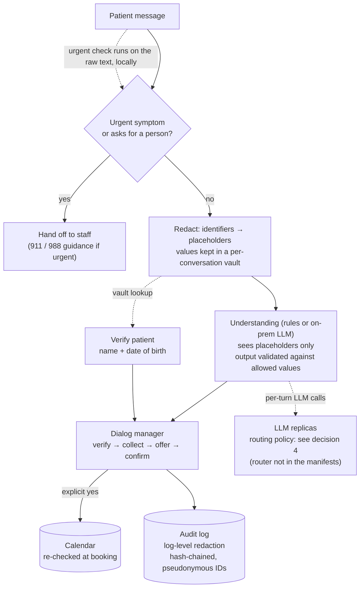

# Healthcare Scheduling Agents: PHI Minimisation, Guardrails and Cache-Aware Routing

**A multi-turn appointment-scheduling agent built for a regulated setting.**
- It verifies the patient, books or cancels only after an explicit "yes", and hands off to
  staff on urgent symptoms or repeated failure.
- Its language layer and logs never see the patient's identity.
- A routing simulation shows when sending a conversation back to the replica that holds its
  KV cache pays off, and how much capacity it adds.

> **Honest framing.** This is not client code and it is not a benchmark of a production
> system. It rebuilds the design as runnable, tested code. Every claim is labelled:
> **Tested** (behaviour verified by the test suite), **Demonstrated** (scripted runs
> whose output is committed), **Measured (simulation)** (produced by a simulation with
> stated assumptions), or **Designed** (configuration for infrastructure that is not run
> here). No model or GPU is run, and no accuracy or latency numbers from
> real hardware are reported.

## The problem

Patients book, move and cancel appointments by chat at all hours. An agent that does this
has three constraints a generic chatbot does not have.

- **It handles protected health information (PHI).** Names, dates of birth, phone numbers
  and record numbers arrive in free text. They must not leak into logs, analytics or a
  model provider.
- **It acts on a real calendar.** A misunderstanding cannot be allowed to book the wrong
  slot or cancel the wrong visit.
- **Some messages are not scheduling requests at all.** "I've had chest pain since this
  morning" must stop the flow at once.

And because every turn re-sends the whole conversation, serving cost and time to first
token depend on where each turn is routed.

## Architecture



## Design decisions

### 1. Minimise PHI before it moves — *Tested*, [`phi/redact.py`](phi/redact.py)

Identifiers are replaced with typed placeholders: name, date of birth, phone, email, SSN,
medical record number, street address and ZIP. Each is covered in the formats people
actually type:
- dates as `03/14/1985`, `1985-03-14`, `14 March 1985` or `3.14.85`
- SSNs with or without dashes
- addresses with units
- names such as O'Brien, McDonald, Mary-Ann and José Núñez

While the agent is asking for identity details it redacts more aggressively: any date
counts as a date of birth, lower-case names count, and a bare "Maria Lopez 03/14/1985" is
recognised without cue words. The real values go into a vault that exists only for that
conversation. There are two redaction levels:

| Level | Used for | Keeps |
|---|---|---|
| prompt | the language layer | appointment dates and "next Tuesday", which it needs to understand the request |
| log | the audit trail | no identifiers and no explicit dates |

Verification reads the real name and date of birth from the vault. Replies to the patient
are restored from the vault ("Thanks, Maria Lopez") after the model and the log have only
seen `[NAME_1]`. A test runs a full booking carrying all eight identifier types, and checks
that none of them, nor the internal patient ID, appears in anything the language layer
received or the log stored.

**What this is not.** It is pattern-based minimisation, not HIPAA de-identification.
- Safe Harbor lists 18 identifier types, and an appointment date tied to a person is
  itself PHI.
- So the model must still run inside the HIPAA boundary, which is why the serving design is
  on-prem (decision 5). Redaction is defence in depth, not a substitute.

### 2. Language can misunderstand; it cannot act — *Tested*, [`agent/scheduler.py`](agent/scheduler.py), [`agent/model_nlu.py`](agent/model_nlu.py)

The understanding layer, whether rules or an LLM, only fills a small structured frame:
intent, department, day, part of day, which option, yes or no. The dialog manager decides
what happens. With an LLM, its JSON is checked against fixed allowed values; a department
the clinic doesn't offer, a malformed date or extra keys are dropped, not acted on.

Guardrails, each covered by a test:
- **Urgent symptoms end the automated flow on any turn.** That includes mid-booking and
  after the conversation has ended.
  - The check runs on the raw message, locally, before anything else; it is never
    delegated to the model.
  - It is apostrophe-insensitive ("cant breathe", "can't", "can’t").
  - The message is not sent to the language layer at all.
- **Nothing is booked or cancelled without a read-back and an unambiguous "yes".**
  - "yes no", "that's not correct", "don't book it" and "I'm not sure that works" are not
    a yes.
  - Nor is "yes, cancel that" during a booking.
- **A named time wins over an option number.** Bare "one" is never read as option 1
  ("can I get the 1:30 one").
- **The slot is re-checked at booking.** If someone took it after it was offered, the
  patient gets fresh options, and the slot is never double-booked.
- **Handoff to staff happens on any of these:**
  - three failed verifications
  - three turns without identity details
  - two turns without progress once verified
  - a request for a person

### 3. An audit trail that shows tampering — *Tested*, [`agent/audit.py`](agent/audit.py)

Every patient message, agent reply and system event (verified, booked, cancelled, handoff)
is logged with log-level redaction. Patient IDs are written as keyed pseudonyms
(HMAC-SHA-256): an auditor with the key can link entries to a record, but the log alone
cannot. Outside development, a missing key is an error, not a silent fallback. Each entry's hash covers the previous one, so editing or deleting any entry breaks
verification from that point; the tests check both.

### 4. Routing multi-turn conversations — *Measured (simulation)*, [`routing/prefix_routing_sim.py`](routing/prefix_routing_sim.py)

Each turn re-sends the system prompt and the whole history. A replica that served the
previous turn still holds that in its KV cache, so it only prefills the new message; any
other replica prefills the whole history. Four policies run on the same traffic:
- 4 replicas, 8-turn conversations
- a 1,500-token system prompt, cached once per replica
- 8,000 prefill tokens/s per replica, an assumption

**Load** is the prefill utilisation each replica would have if every turn re-read its
whole history. Above 1.0, a cache-blind fleet cannot keep up at all; only cache reuse makes
it feasible. **History reused** is the share of history tokens served from cache.

| Load | KV cache per replica | Round-robin p50 / p99 | Least-loaded | Sticky (hash) | KV-aware |
|---|---|---|---|---|---|
| 0.5 | 400k tokens | 30 / 165 ms | 30 / 165 | **7.5 / 13.5** | 7.5 / 143 |
| 1.0 | 400k tokens | 95 / 430 ms | 55 / 241 | **7.5 / 18** | 7.5 / 165 |
| 1.5 | 400k tokens | 1.2 s / 483 s | 129 s / 251 s | **7.5 / 172** | **7.5 / 165** |
| 2.0 | 400k tokens | 321 s / 549 s | 320 s / 535 s | 58 / 619 | **65 / 368** |
| 0.5 | 40k tokens | 98 / 255 ms | 75 / 202 | 92 / 388 | **67 / 178** |
| 1.0 | 40k tokens | 2.6 s / 13.5 s | 2.3 s / 6.7 s | 4.6 s / 12.7 s | **1.8 s / 6.4 s** |

All values are time to first token (TTFT), p50 / p99. Full sweep:
[`results/routing.txt`](results/routing.txt).

What it shows:
- **Cache affinity cuts median TTFT 4–13× against round-robin** at loads round-robin can
  still sustain (0.5× and 1×), when the cache can hold the active conversations. The new
  turn is 60 tokens of prefill instead of hundreds.
- **It roughly doubles capacity.**
  - At 1.5× and 2×, the cache-blind policies are overloaded, with queues running to
    minutes.
  - Sticky and KV-aware routing still answer in tens of milliseconds at the median.
- **Sticky hashing has the best tail until its imbalance shows.**
  - It never moves a conversation, so it never pays a cold prefill.
  - It also ignores load. At 2× its p99 is 619 ms, against 368 ms for KV-aware.
- **KV-aware routing** minimises backlog plus the cost of the uncached tokens; that is the
  cost function Dynamo's KV router uses.
  - It is greedy: at lighter load it sometimes moves a conversation to an idle replica and
    pays a cold prefill once, which is why its p99 is about 140–165 ms where sticky's is
    13–18 ms.
  - It is the most robust choice under pressure, and with a small cache.
- **Cache size decides whether affinity matters at all.** With a cache too small for the
  active conversations, little history is reused and every policy collapses past 1×.
  Measure the cache footprint of active conversations before choosing a policy.

Real numbers depend on the model, GPU and traffic; the simulation shows the shape.

### 5. On-prem serving with no way out — *Designed*, [`serving/k8s/`](serving/k8s)

- **An NVIDIA NIM deployment** for the language layer (TensorRT-LLM inside,
  OpenAI-compatible API):
  - KV-cache reuse enabled
  - non-root
  - weights pre-loaded into a cache volume, so nothing is pulled from the internet at
    runtime
- **Network policies for both namespaces that handle PHI:**
  - **The LLM namespace** accepts requests only from the agent and reaches only cluster
    DNS.
  - **The agent namespace,** which holds raw PHI in the vault, reaches only DNS, the LLM and
    the scheduling integration, and accepts traffic only from the ingress gateway.
  - Neither has a route to the internet; a misbehaving component cannot send data out. That
    holds on a cluster whose network plugin enforces NetworkPolicy, as the file notes.
- **Not included:** the Service and the KV-aware router in front of the LLM replicas.
  Decision 4 models that choice.

## What runs here

| Component | Status | Where |
|---|---|---|
| PHI redaction, vault, two redaction levels | **Tested** | [`phi/`](phi) |
| Scheduling agent: verify, collect, offer, confirm, book/cancel, handoffs | **Tested** | [`agent/`](agent) |
| Model-based understanding with validated JSON output | **Tested** (with a stand-in model) | [`agent/model_nlu.py`](agent/model_nlu.py) |
| Hash-chained audit log with pseudonymous IDs | **Tested** | [`agent/audit.py`](agent/audit.py) |
| Four demo conversations (book, cancel, failed verification, urgent) | **Demonstrated** | [`demo.py`](demo.py), [`results/conversations.txt`](results/conversations.txt) |
| KV-cache-aware routing comparison | **Measured (simulation)** | [`routing/`](routing), [`results/routing.json`](results/routing.json) |
| NIM deployment and network policies | **Designed** (YAML and key fields checked by tests) | [`serving/k8s/`](serving/k8s) |
| Against a real model, EHR or GPU | **Not covered** | — |

74 tests in total, including a regression test for every case an independent review used to
break an earlier version.

## Run it

```bash
pip install -r requirements.txt
./run_all.sh          # demo conversations, routing sweep, tests (~1 minute, CPU only)
```

## Limitations

- **Redaction is pattern-based.** It covers the identifiers scheduling conversations carry,
  not free-text clinical notes, which need a trained de-identification model.
- **Third-party names can reach the model.** A name mentioned without a cue ("my husband
  Carlos also needs one") is not redacted; only the patient's own, verified name is removed
  everywhere.
- **The rule-based reader handles a narrow phrasing range.** A real deployment uses the
  model path, with the same validation.
- **Urgent-symptom detection is a keyword list.** It errs towards handing off, and it must
  be reviewed with clinicians.
- **The routing model counts prefill only and assumes a fixed prefill rate.** Decode
  contention, batching effects and cache transfer between replicas are not modelled, and
  KV-aware routing here is greedy, with no penalty for giving up a conversation's cache.
- **The calendar and patient records are in-memory stand-ins for EHR scheduling APIs.**

## Author

Saurabh Rai — AI infrastructure solution architecture.
GitHub: [saurabh9498](https://github.com/saurabh9498) · LinkedIn: [saurabh-rai-aipm](https://www.linkedin.com/in/saurabh-rai-aipm/)
