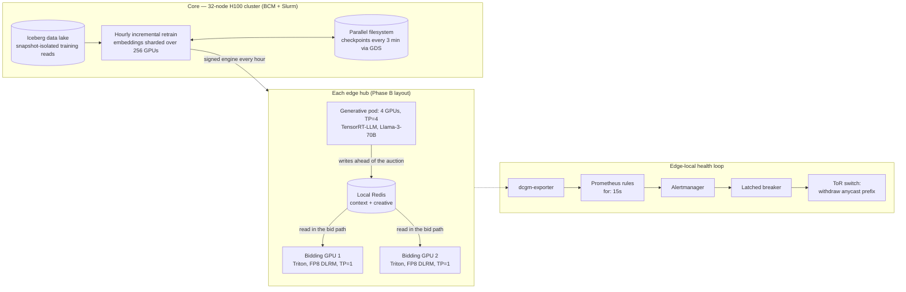

# Edge Inference and Training Scale-Out for Real-Time Bidding

**A reconstruction of the second and third phases of a real-time bidding platform:
moving GPU inference from the cloud to bare-metal edge hubs, partitioning each
hub between a synchronous bidding model and an asynchronous LLM, then doubling volume —
70B generative pods on TP=4 at the edge, and a 32-node H100 cluster for hourly retraining
at the core.**

> **Honest framing.** This is not client code and it is not a benchmark of the production
> system. It rebuilds the design as runnable control logic, simulations, configuration and
> sizing math. Every number is labelled: **Measured** (produced by code here),
> **Derived** (arithmetic reproduced by a script here), or **Designed** (configuration for
> hardware that is not run here). Phase 1, the cloud A10G fleet, is in
> [`rtb-gpu-inference`](../rtb-gpu-inference).

## The two problems

**Phase A — repatriation.** In the cloud, ~30 ms of network transit between the exchange
and the region left too little of the 100 ms budget for a heavier multimodal model, and
data-transfer charges grew with every model push. Moving inference onto bare-metal edge
hubs a few milliseconds from the exchanges solved both. The hubs run 96 GB RTX PRO 6000
Blackwell GPUs.

**Phase B — scale-up.** Daily volume doubled, the product began generating ad creative
with a 70B model, and the hourly retrain stopped fitting on one 8-GPU node: streaming the
training window and paging cold embeddings over PCIe starved the GPUs, and the run passed
90 minutes against a 60-minute deadline.

## Architecture



## Design decisions and the numbers behind them

### 1. Separate GPUs for separate jobs — *Derived*, [`sizing/fleet.py`](sizing/fleet.py)

The bid must return in milliseconds; the LLM takes 100+ ms. They never share a GPU: an
LLM's prefill and KV-cache traffic creates memory-bandwidth spikes that would land
directly on the bidding model's p99. The LLM runs ahead of the auction and leaves its
output in local Redis; the bid path only reads it.

| | Phase A | Phase B |
|---|---|---|
| Hubs | 5 | 10 |
| Per hub | 2 bidding (TP=1) + 1 LLM (Llama-3-8B, TP=1) | 2 bidding (TP=1) + 4 LLM (Llama-3-70B, one TP=4 group) |
| Total GPUs | **15** | **60** |
| Average | 17,361 QPS (1.5B a day) | 34,722 QPS (3B a day) |
| Design peak (input) | 50,000 QPS | 100,000 QPS (same peak-to-average ratio) |
| Peak per bidding replica | **5,000 QPS** | **5,000 QPS** |

Doubling the hubs keeps the load on each bidding replica constant. Bidding runs as two
**independent TP=1 replicas** per hub rather than one TP=2 group, for three reasons:
- One GPU failing halves the hub's capacity instead of zeroing it.
- New engines can be rolled out one GPU at a time.
- No inter-GPU traffic sits in the bid path.

The cost is that a lone survivor carries 10,000 QPS, double its design load. That is why
a hardware fault withdraws the whole hub from routing (decision 5) rather than limping on.

### 2. KV cache, and why the 70B model needs TP=4 — *Derived*, [`sizing/kv_cache.py`](sizing/kv_cache.py)

KV cache per token = 2 × layers × KV heads × head dim × bytes (FP8 = 1 byte):

| Model | Per token | Context | Per stream | Streams | Pool |
|---|---|---|---|---|---|
| Llama-3-8B (32 layers, 8 KV heads, dim 128) | 64 KiB | 1,024 | 64 MiB | 128 | **8 GiB (8.6 GB)** |
| Llama-3-70B (80 layers, 8 KV heads, dim 128) | 160 KiB | 1,280 | 200 MiB | 500 | **97.7 GiB (104.9 GB)** |

The 8B context model uses ~21 GB of a 96 GB card (78% free). For the 70B creative model,
FP8 weights (70 GB) plus the KV pool (104.9 GB) decide the layout:

| TP | Pool | Used | Headroom | Verdict |
|---|---|---|---|---|
| 1 | 96 GB | 178 GB | −82 GB | Does not fit |
| 2 | 192 GB | 182 GB | 10 GB (5%) | Fits on paper; one burst away from out-of-memory |
| **4** | **384 GB** | **189 GB** | **195 GB (51%)** | **Chosen** |

TP must divide the 8 KV heads, so 3 is not an option. These cards have no NVLink, so the
TP=4 group communicates over PCIe Gen5. That is fine for throughput, but it makes the
group as fast as its slowest card — which drives the thermal rule in decision 5.

### 3. Never wait for context in the bid path — *Measured (tests)*, [`context/context_fallback.py`](context/context_fallback.py)

The first ad slot can bid ~15 ms after page load, but the page's LLM vector takes
100–150 ms. The resolver takes the best vector that exists right now:
1. the page vector,
2. a 24-hour cached domain vector,
3. a default vector with no context.

It counts which tier served each bid, so context coverage is a monitored number rather
than an assumption.

### 4. Surviving a flash crowd — *Measured (simulation)*, [`sim/flash_crowd_sim.py`](sim/flash_crowd_sim.py)

A live event sends 18% of one replica's 5,000 QPS to 600 rows that were cold an hour ago.

| | Hit rate before | First second of crowd | Settled | Recovers in |
|---|---|---|---|---|
| Static hot list | 98.0% | 80.6% | 80.4% | never |
| Adaptive promotion (>5 fetches in 10 s) | 98.0% | 88.0% | 98.1% | **30 s** |

Every miss is a Redis round trip, so the static list's 80% is a sustained p99 problem. The
adaptive rule promotes rows that are demonstrably hot into a small reserved slice. The
recovery time follows from the threshold and window, which are the knobs to tune.

### 5. A latched circuit breaker from GPU health to BGP — *Measured (tests)*, [`circuit_breaker/`](circuit_breaker)

Every hub announces the same anycast prefix, so each bid goes to the nearest hub. A hub
with a dead GPU must stop announcing, or its bids time out. The breaker withdraws the
prefix through the switch's eAPI. Flapping is the real danger, so it has three guards:

1. **Persistence.** A fault must hold for 15 s (the Prometheus rule's `for:`).
2. **Latching.** A fault that clears does not re-announce the prefix.
3. **Slow restore.** Re-announcing needs 30 minutes of continuous health or an operator
   reset; any new fault restarts the clock.

The tests cover both kinds of flapping:
- A raw signal that is up 10 s and down 5 s never trips, because it never persists for 15 s.
- An alert that fires and clears every 30 seconds for 20 minutes produces **exactly one**
  withdrawal.

The breaker writes its state to disk on every change, so a restarted breaker still knows
the prefix is withdrawn and still finishes the cooldown. An operator reset (`POST /reset`)
is refused while any fault is active. Both endpoints require a bearer token, so not every
pod that can reach the service can withdraw a hub.

What counts as fatal ([`prometheus-rules.yaml`](alerting/prometheus-rules.yaml), checked
with `promtool`):
- **Xid 48, 79 and 95** (double-bit ECC, fell off the bus, uncontained ECC). Xid 94, a
  contained ECC error, usually recovers and pages a human instead.
- **A missing GPU.** A card that falls off the bus stops reporting, so no per-GPU rule can
  fire for it. The rule counts GPUs per host instead.
- **Sustained thermal throttling,** which is fatal for a TP=4 group because three healthy
  GPUs wait on the hot one every step. The rule needs a thermal bit set in the clock-reasons
  bitmask *and* an SM clock 15% below the fastest card in the chassis, so brief, harmless
  throttles don't fire.

**Alerting is edge-local.** A hub that loses its link to central monitoring keeps serving
and decides its own health; only the hub withdraws its own prefix. Every breaker alert also
pages a human ([`alertmanager.yaml`](alerting/alertmanager.yaml), checked with `amtool`).

### 6. Hourly retraining on 32 nodes — *Derived*, [`training/recovery_math.py`](training/recovery_math.py)

- **Why 32 nodes.** 256 H100s hold **20.48 TB** of HBM, so the 1.2 TB of embeddings can be
  sharded entirely in GPU memory. Nothing pages over PCIe during the run. The dense layers,
  which had grown about 10× for multimodal fusion, run data-parallel with pipeline stages.
- **Why Slurm.** Sharded embeddings and collectives over every rank mean the job needs all
  32 nodes or none. That is gang scheduling, which Slurm does natively
  ([`retrain.sbatch`](training/retrain.sbatch)).
- **Why checkpoint every 3 minutes when failures are weeks apart.**
  - The classic Young/Daly formula, √(2 × checkpoint cost × MTBF), suggests about every
    **1.4 hours** for a 10 s cost and a two-week mean time between failures (MTBF).
  - That formula minimises *average* waste. A hard 60-minute deadline cares about the
    *worst* case.
  - With 3-minute checkpoints, a failure costs a ~2 minute restart (which includes the 12 s
    state read) plus up to 3 minutes of lost work: **3.5 minutes on average, 5 at worst.** A
    50-minute retrain still finishes on time.
  - With hourly checkpoints, the worst case is 62 minutes and it does not.
  - Asynchronous GPUDirect Storage writes to an in-rack parallel filesystem are what make
    frequent checkpoints affordable.

## What runs here

| Component | Status | Where |
|---|---|---|
| Latched breaker, persisted state, eAPI command builder, authenticated webhook | **Measured** (16 behaviour tests) | [`circuit_breaker/`](circuit_breaker) |
| Tiered context fallback | **Measured** (tests) | [`context/`](context) |
| Flash-crowd cache simulation | **Measured** (simulation) | [`sim/`](sim), [`results/`](results) |
| KV-cache, TP, fleet and recovery sizing | **Derived** (scripts + tests) | [`sizing/`](sizing), [`training/`](training) |
| Prometheus rules, Alertmanager routing | **Designed** (validated with `promtool` and `amtool` in the tests) | [`alerting/`](alerting) |
| Slurm retrain job | **Designed** | [`training/retrain.sbatch`](training/retrain.sbatch) |
| Against a real switch, GPUs or cluster | **Not covered** | — |

## Run it

```bash
pip install -r requirements.txt
./run_all.sh                        # regenerates results/ and runs the tests (seconds)
BREAKER_STATE=/tmp/breaker.json python circuit_breaker/webhook_server.py --prefix 203.0.113.0/24 --dry-run
```

The `promtool` and `amtool` tests are skipped if those binaries are not on your PATH.

## Limitations

- The breaker has never been run against a real Arista switch from this repo;
  `DryRunClient` records the commands instead.
- The flash-crowd simulation uses a scaled-down row count with a skew calibrated to a 98%
  baseline. Real crowds differ in size, spread and duration.
- The VRAM plans are static allocations; real engines also fragment memory.
- The deadline argument assumes at most one failure per retrain window.
- The rules assume a 5-second scrape and evaluation interval; at Prometheus defaults,
  `for: 15s` would mean considerably longer.

## Author

Saurabh Rai — AI infrastructure solution architecture.
GitHub: [saurabh9498](https://github.com/saurabh9498) · LinkedIn: [saurabh-rai-aipm](https://www.linkedin.com/in/saurabh-rai-aipm/)
