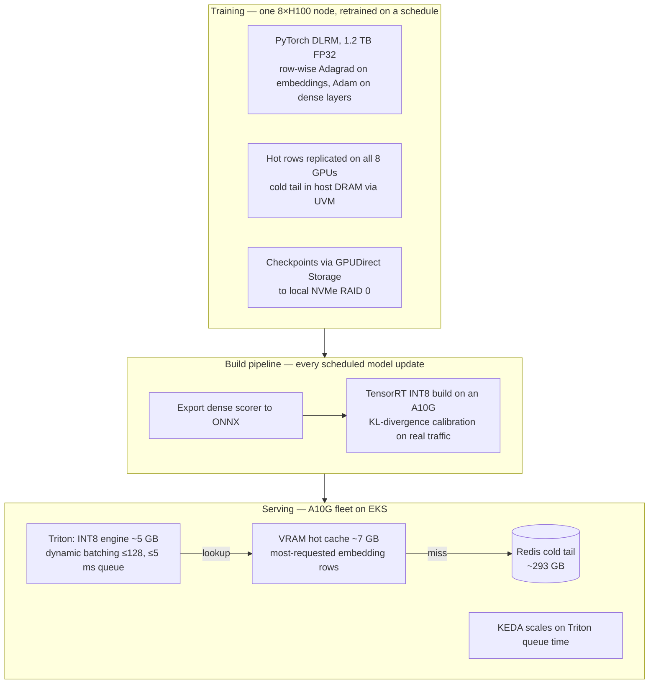

# Real-Time Bidding on GPUs: DLRM Inference Under a 100 ms Timeout

**A reconstruction of the architecture behind a CPU-to-GPU migration for real-time ad
bidding: a 1.2 TB DLRM trained on one 8×H100 node, compiled to INT8 TensorRT, and served
by Triton on a fleet of 24 GB A10G GPUs in EKS.**

> **Honest framing.** This is not client code and it is not a benchmark of the production
> system. It rebuilds the design as runnable code, configuration and sizing math. Every
> number below is labelled: **Measured** (produced by code in this folder), **Derived**
> (arithmetic from stated inputs, reproduced by a script here), or **Designed** (a
> configuration or script for GPU hardware that is not run here).

## The problem

An ad exchange gives a bidder **100 ms** from request to bid price. A late bid is a lost
bid. A gradient-boosted model on CPUs was fast enough until the feature space grew and
the platform moved to a **Deep Learning Recommendation Model (DLRM)**. On CPUs the DLRM
forward pass pushed latency past the timeout, so a large share of bids on the most
valuable audience segments were dropped. Adding CPUs does not fix that: it is a
throughput-per-request problem, so the silicon had to change.

## Architecture



The model is split on purpose. The **embedding tables** (almost all of the 1.2 TB) are
served outside the inference engine, from a VRAM hot cache with a Redis cold tail. Only
the **dense scorer** (bottom MLP, feature interaction, top MLP) is compiled into the
TensorRT engine. [`model/dlrm.py`](model/dlrm.py) implements exactly that split, and a
test confirms it computes the same function as the unsplit model.

## Design decisions and the numbers behind them

### 1. Training a 1.2 TB model on a 640 GB node — *Derived*, [`sizing/training_memory.py`](sizing/training_memory.py)

| Problem | Numbers | Fix |
|---|---|---|
| Naive Adam training needs weights + gradients + two optimizer states | 4 × 1.2 TB = **4.8 TB** vs **640 GB** HBM (7.5× over) | Row-wise sparse Adagrad on embedding tables: one FP32 accumulator per row, **9.4 GB** instead of 2.4 TB of Adam state. Adam kept for the small dense layers. Cold rows tiered to the node's 2 TB host DRAM via Unified Virtual Memory (UVM). |
| Zipfian traffic sends most lookups to one or two GPUs and saturates the AllToAll | — | Replicate the hottest **3% (36 GB)** of rows on every GPU: **288 GB** of HBM traded for local reads. |
| `torch.save` goes through a CPU bounce buffer | 1.2 TB at ~5 GB/s ≈ **240 s** of idle H100s per checkpoint | GPUDirect Storage straight to NVMe: at 45 GB/s, **27 s**. |

The UVM trade-off is deliberate: a host-memory lookup crosses PCIe Gen5 at ~64 GB/s
against ~3,350 GB/s of HBM3, about **52× slower**, so it is confined to rows that are
rarely touched.

### 2. Fitting the serving footprint in 24 GB — *Derived*, [`sizing/vram_budget.py`](sizing/vram_budget.py)

INT8 post-training quantization cuts the 1.2 TB FP32 embeddings to **300 GB**: still
12× the GPU. So each A10G's 24 GB is split three ways:

| Slice | Size | Why |
|---|---|---|
| INT8 TensorRT engine (dense layers) | ~5 GB | Reserved for the production scorer. (The stand-in model in this repo compiles to a few MB.) |
| Runtime workspace | ~12 GB | Activations for 128-request batches, TensorRT scratch, CUDA context. Cutting it to grow the cache causes out-of-memory errors at peak. |
| Hot embedding cache | ~7 GB | **54.7M rows of 2.34B (2.33%)**, assuming 128-dim INT8 rows. Small tables (device type, ad format) sit here in full. |
| Redis cold tail | ~293 GB | One network hop away. |

### 3. Does a 2.3% cache absorb the traffic? — *Measured (simulation)*, [`sim/hot_cache_sim.py`](sim/hot_cache_sim.py)

It depends on how skewed the traffic is. Under a Zipf law with exponent *s*, the
per-lookup hit rate for a cache holding the top 2.33% of 2.34B rows is:

| Zipf *s* | 0.9 | 1.0 | 1.1 | 1.2 |
|---|---|---|---|---|
| Hit rate per lookup | 64.8% | 83.0% | 94.4% | 98.6% |

A **98% hit rate needs *s* ≥ 1.17.** The analytic formula agrees with a Monte Carlo
simulation to within 0.03 percentage points in the committed run; the tests enforce
0.2 points.

Training's skew is lower: if the top 3% of rows carry 80% of lookups, *s* ≈ 0.97. My
reading is that the serving cache refreshes its hot list from a short recent window, which
is more concentrated than a training window covering days. Either way, the skew of your own
traffic decides how big the cache must be, so measure it before sizing.

### 4. The latency budget — *Derived*, [`sizing/latency_budget.py`](sizing/latency_budget.py)

| Stage | ms |
|---|---|
| Network in (exchange → load balancer → pod) | 5 |
| Triton queue (dynamic-batching cap) | 5 |
| INT8 forward pass | 25–30 |
| Network out | 5 |
| **Hot path p99** | **45** |
| Cold path (+ one Redis round trip, ~15 ms) | 60 |

Two traps sit in this table.

- **The hit rate is per lookup, not per request.** A request goes cold if *any* of its
  lookups into a big table misses. Only the two huge ID tables (user and device) have cold
  tails; the small tables live in VRAM in full. At 98% per lookup, 1 − 0.98² ≈ **4% of
  requests** go cold. All of a request's misses go in one batched Redis call, so it pays one
  hop, not several. If all 26 tables could miss, 41% of requests would go cold.
- **4% is more than the 1% tail that p99 describes.** So the blended p99 is bounded by the
  cold path, **~60 ms, not a weighted average.** That still clears 100 ms. Treat 60 ms as
  conservative: it assumes the cold requests run at the cold path's own p99. Getting p99
  back onto the hot path needs fewer than 1% cold requests, which means a **per-lookup hit
  rate above 99.5%**.

### 5. Build and serving configuration — *Designed*

- **Compile on the target silicon.** TensorRT picks kernels for the exact GPU it builds on,
  so the engine is built on a transient A10G builder node
  ([`build/build_engine.sh`](build/build_engine.sh)).
- **KL-divergence INT8 calibration** on real traffic, so rare activation outliers do not
  stretch the quantization scale ([`build/calibrator.py`](build/calibrator.py)).
- **Dynamic batching capped at 5 ms and 128 requests**, matching the queue slice of the
  latency budget ([`config.pbtxt`](serving/model_repository/dlrm_dense/config.pbtxt)).
- **Autoscaling on GPU queue time, not CPU.** CPU lags bursty bid traffic. KEDA scales
  when Triton's average queue time passes 15 ms
  ([`keda-scaledobject.yaml`](deploy/k8s/keda-scaledobject.yaml)).
- **A 5-minute startup probe.** An init container pulls ~12 GB (engine plus hot-cache
  snapshot), then Triton loads both into VRAM and warms up. A liveness probe tuned for
  steady state would kill Triton mid-load and loop forever, so the startup probe holds it
  off for up to 5 minutes ([`triton-deployment.yaml`](deploy/k8s/triton-deployment.yaml)).
- **A 5-second preStop hook**, so a spot-instance reclaim drains the in-flight batch
  instead of dropping it.

## What runs here

| Component | Status | Where |
|---|---|---|
| DLRM model and serving split, verified equal to the full model | **Measured** (test) | [`model/`](model) |
| ONNX export, verified against PyTorch output | **Measured** (test) | [`model/export_onnx.py`](model/export_onnx.py) |
| Training memory, VRAM and latency sizing | **Derived** (scripts + tests) | [`sizing/`](sizing) |
| Hot-cache hit rate vs traffic skew | **Measured** (simulation) | [`sim/`](sim) |
| Batch-size vs latency/throughput on CPU | **Measured** (CPU only) | [`bench/`](bench), [`results/bench_cpu.json`](results/bench_cpu.json) |
| TensorRT INT8 build and calibration | **Designed** (needs an A10G) | [`build/`](build) |
| Kubernetes and KEDA manifests | **Designed** (YAML and key fields validated by tests) | [`deploy/`](deploy) |
| Triton model configuration | **Designed** (not tested) | [`serving/`](serving) |

**The CPU benchmark** shows the trade-off Triton's batcher manages. In the committed run
on a 2-core sandbox, batch 128 delivered about **3.9×** the throughput of batch 1 while
median latency rose from 0.04 ms to 1.2 ms. On shared hardware the multiple moves between
runs, roughly 4× to 8× across the runs made while building this; the shape is the point,
not the number. The model is a laptop-sized stand-in, so these are not A10G numbers.

## Run it

```bash
pip install -r requirements.txt
./run_all.sh          # regenerates results/ and runs the tests (~1 minute, CPU only)
```

## Limitations

- The model is a small stand-in (26 tables × 100k rows). Production scale is handled by
  the sizing scripts, not by instantiating a 1.2 TB model.
- Nothing in `build/`, `serving/` or `deploy/` has been run against GPUs from this repo.
- The latency budget assumes each path runs at its own p99; real distributions overlap,
  so the real blended p99 sits below the 60 ms bound.
- The INT8 build uses TensorRT 8.6 implicit calibration. TensorRT 10 replaces it with
  explicit Q/DQ quantization from TensorRT Model Optimizer.
- The Zipf model is an assumption. Real traffic drifts with time of day and live events,
  which is why the hot list has to be refreshed rather than computed once.

## Author

Saurabh Rai — AI infrastructure solution architecture.
GitHub: [saurabh9498](https://github.com/saurabh9498) · LinkedIn: [saurabh-rai-aipm](https://www.linkedin.com/in/saurabh-rai-aipm/)
